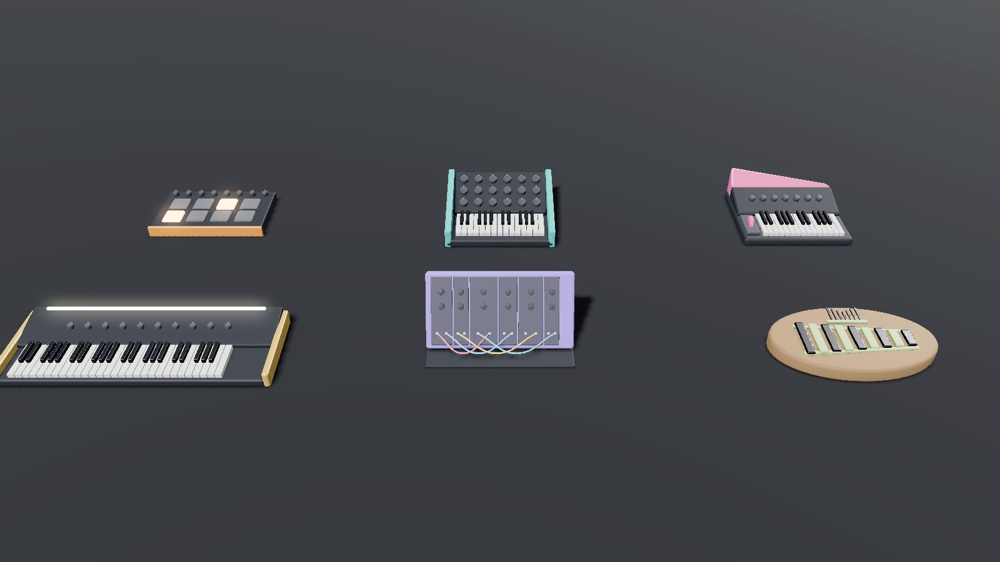

# AudioSyncMaster

Multiplayer XR jam sessions: remote musicians hear each other in sync with spatial audio, play real instruments or seven built-in synths, with sequencers, loopers and a shared metronome. See `DESIGN.md` for the full plan and `CLAUDE.md` for working rules.

**New here? Read the [User Manual](docs/MANUAL.md).**


Godot 4.7.2 (GL Compatibility). The instruments come from **SynthKit** (`D:\Godot_Projects\SynthKit`), the studio's shared synth addon (C++ engine, panels, presets), included as a git submodule at `addons/synthkit` (github.com/sterlingy/SynthKit).

## Status
- **M1 synths: done** (Windows). Six instruments (now seven, with Prism from SynthKit) with full panels, 48 factory presets (56 with Prism's), user presets, share codes, MIDI input (USB, Android USB/BLE, Wi-Fi relay) with MIDI learn, on-screen keys and drum pads, Tangle patch editor.
- **M2 clock, metronome, sequencers, quantize: done locally.** Network clock sync arrives with M4.
- **M3 loopers: done.** Note loops for virtual instruments and audio loops for mics/real instruments (Looper tab, "Records: Audio input"), cut at the bar lines you heard; the master looper is shared in sessions and takes both.
- **M4 LAN sessions: done on Windows.** Host or join from the **Jam** tab (up to 6 players). Clock sync to within ~0.1 ms, tempo and transport follow the host, everyone's sound/sequencer/loops play in sync from the shared clock, live notes go player to player and are scheduled on the audio link's network thread (no frame delay), and mic/instrument audio streams per player over AOO (PCM or Opus) with native WASAPI capture (shared, or exclusive for ~3 ms input periods). Per-player volume, mute and latency display.
- **M5 export: done.** **● Rec jam** records what you hear: `stem_<player>.wav` for each player, `mixdown.wav`, `jam.mid` (every note that played, a track per player, tempo map) and `session.json` with loop clips, under `user://jams/<date>/`. **Load session…** in the Jam tab loads it back. **Share…** shows a preset's code as a QR image and saves it as a PNG.
- **Since M5:** **Tap** tempo and a click-volume slider; players' tempo changes reach the host as suggestions (Accept/Ignore). **Interval mode** (Jam tab → Timing) plays everyone else exactly 1 or 2 bars late so far-away players land in time; the Jam tab suggests it when someone reaches you more than 40 ms late. **Send instrument as audio** streams your instrument instead of notes. Avatars' head/hand poses are sent and shown delayed to match each player's sound (for XR). **MIDI…** dialog with Bluetooth MIDI scan, input channel and the Wi-Fi relay. The UI wraps and scrolls on small screens, the on-screen keys take multi-touch chords, and phones scale the UI by screen density.
- **M7 3D instruments: first pass.** Six stylized models made in Blender (`assets/instruments/*.glb`, source `.blend` alongside); `scenes/instrument_gallery.tscn` shows them. 
- **M8 online sessions: built, waiting for a server.** `server/asm_server.py` gives the host a room code; others press **Join online** and type it. It only introduces players and opens direct paths through home routers; see `server/README.md`. Tested through a local server; a real test over the internet needs the server on a public machine. Strict NATs will need a relay (not built).
- **Android:** arm64 engine builds with AOO; `build/android/AudioSyncMaster.apk` (flat, debug) exports with the MIDI plugin. Mic input uses Godot's microphone there. Untested on a device.
- Headset steps wait in `docs/TODO-headset.md`.

Keys: Space = play/stop, R = looper record/overdub.

## Jamming on a LAN
1. One player opens the **Jam** tab and presses **Host a jam**; the status line shows their IP.
2. Others type that IP and press **Join**. Windows asks once to allow Godot on private networks: allow it (UDP 47830-47831, plus an audio port and a notes port per player).
3. Turn on **Send my audio** to stream your mic or interface input (pick the device and channel). Use headphones and your interface's direct monitoring.
4. The host's tempo and play/stop apply to everyone; others' changes are sent to the host.

Two instances on one PC: `godot --path . -- --host --name=A` and `godot --path . -- --join=127.0.0.1 --name=B`.

Rebuilding the Android export needs the gradle template: `godot --headless --install-android-build-template --export-debug "Android (flat)" build/android/AudioSyncMaster.apk` (the generated `android/` folder is git-ignored).

| Instrument | Role | Notes |
|---|---|---|
| **Pulsar** | Drums / beat maker | 8 synthesized voices (GM drum notes; on a plain keyboard C, C#, D… play kick, snare, clap…) |
| **Undertow** | Bass | Three VCOs, mixer with feedback loop, 24 dB ladder, two contours, glide |
| **Comet** | Lead | Two VCOs with hard sync, sub, multimode filter, vibrato, portamento, ping-pong delay |
| **Lumen** | Keys / pads | 8 voices, LFO, drift, chorus, reverb |
| **Driftwood** | Plucks / mallets | Karplus-Strong string; marimba, vibes, kalimba, bell, glass modal models |
| **Tangle** | Modular | 12 modules (MIDI→CV, Clock, VCO, Noise/S&H, VCF, Dual VCA, ADSR, LFO, Step Sequencer, Utility, Delay, Reverb+Output) and patch cables |

## Running
1. Get the instruments (the SynthKit submodule, engine binaries included). Clone with `git clone --recurse-submodules`, or in an existing clone:
   ```powershell
   git submodule update --init
   ```
   `tools\update_synthkit.ps1` moves to SynthKit's latest version.
2. Open the project in Godot 4.7.2 and press F5, or run it from the command line.

Playing: MIDI keyboard/controller, or the computer keyboard (A–L white keys, W E T Y U O P black keys, Z/X octave, C/V velocity), or click the on-screen keys. Right-click any knob → **MIDI Learn**, then move a controller knob.

Tangle: drag from an output jack (coloured ring) to an input jack to patch; click a patched input to pull the cable out; drag a module by its title; **+ Module** adds one.

## Tests
```powershell
tools\run_tests.ps1
```
Two-instance session test (starts a second Godot process; checks clock sync, notes, sound/sequencer/looper sync, tempo requests, AOO audio):
```powershell
& "$env:USERPROFILE\Downloads\Godot_v4.7.2-stable_win64.exe\Godot_v4.7.2-stable_win64_console.exe" --headless --path . -s res://tests/tools/net_test.gd
```
Engine tests (pitch accuracy, sample-accurate events, polyphony, sustain, Tangle patching, CPU cost) and preset tests (every preset loads, uses real parameters, renders at a sane level, share codes round-trip).

`tests/tools/render_check.gd` renders every instrument to `test_output/*.wav` for listening.

## Layout
- `addons/synthkit/` — the instruments, from SynthKit: engine binaries (`JamSynth`, `JamAudioLink`, ...), `InstrumentRig`, sequencer, presets, `Transport`, `Midi`, panels, knobs, Tangle editor, keyboard. A git submodule of SynthKit, which also holds the engine source and build scripts.
- `scripts/` — this app: `ui/` (Looper and Jam tabs, MIDI dialog), `looper/`, `presets/` (QR codes), `autoload/` (Settings, MidiNet, MasterLooper), `net/` (Session, clock sync, connection server client, Wi-Fi MIDI relay, poses), `session/` (jam recording), `xr/` (headset scene, hand playing, panel input), `avatar/`.
- `server/` — the connection server for online sessions.
- `assets/instruments/` — the 3D instrument models (Blender source alongside).
