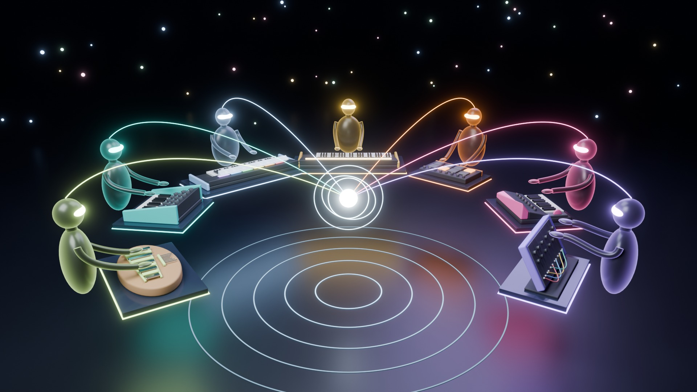

# AudioSyncMaster User Manual

*Jam together in XR, wherever you are.*

AudioSyncMaster lets musicians in different places play together live. You see the other players as avatars and hear everyone in time, with each player's sound coming from where they stand. Play your voice or a real instrument through a mic or audio interface, or one of seven built-in synths. Add step sequencers and loopers, plus a shared master looper and one metronome for everyone.

> **Early preview.** AudioSyncMaster is in development. The desktop version (Windows) is complete; the headset version is a first pass, and online play needs a connection server that isn't hosted publicly yet. This manual describes the app as it is today.

## Contents
1. [What you need](#1-what-you-need)
2. [The screen](#2-the-screen)
3. [Playing an instrument](#3-playing-an-instrument)
4. [The seven instruments](#4-the-seven-instruments)
5. [Sounds and presets](#5-sounds-and-presets)
6. [The clock: tempo, metronome, quantize](#6-the-clock-tempo-metronome-quantize)
7. [Sequencer](#7-sequencer)
8. [Looper and master looper](#8-looper-and-master-looper)
9. [Jamming with others](#9-jamming-with-others)
10. [Your voice and real instruments](#10-your-voice-and-real-instruments)
11. [Recording a jam](#11-recording-a-jam)
12. [MIDI](#12-midi)
13. [In a headset (XR)](#13-in-a-headset-xr)
14. [Getting the lowest delay](#14-getting-the-lowest-delay)
15. [Troubleshooting](#15-troubleshooting)
16. [Shortcuts](#16-shortcuts)

---

## 1. What you need

| | |
|---|---|
| **Computer** | Windows 10 or 11. |
| **Headset** (optional) | Samsung Galaxy XR or XREAL Aura (Android XR), or Meta Quest 2, 3, 3S or Pro. Each has its own app build. The Aura and Quest builds are new and not yet tested. |
| **Headphones** | Wired, or the headset's own speakers. **Not Bluetooth headphones**: they add too much delay to play in time. |
| **To play** | The computer keyboard, the on-screen keys, or any MIDI keyboard/controller (USB, or Bluetooth on Android). |
| **For your voice or a real instrument** | A microphone, or an audio interface with direct monitoring. |
| **To jam with others** | The same local network (LAN or Wi-Fi), or the internet through a connection server (see [Jamming online](#jamming-online)). For headsets: Wi-Fi 6 on 5 GHz, with the router in the same room. |

The app isn't available in a browser: browsers can't send audio the way AudioSyncMaster needs (direct, low-delay UDP between players).

---

## 2. The screen

From top to bottom:

**Top bar**
- **Instrument picker**: choose one of the seven instruments.
- **◀ preset ▶**: pick a sound, or step through them.
- **Save…**: keep the current sound as your own preset.
- **Share…**: turn the sound into a code or QR image, or load someone else's.
- **MIDI…**: MIDI devices, Bluetooth MIDI, input channel and the Wi-Fi MIDI relay.
- **+ Module**: shown for Tangle only; adds a module to the patch.
- **Volume**, a level meter, and **DSP %**: how much of the computer's power your instrument uses.

**Transport bar**
- **▶ Play / ■ Stop**: starts and stops the shared clock.
- **● Rec jam**: records the whole jam.
- Bar.beat position.
- **Tempo** (BPM) and **Tap**.
- **Beats/Bar**.
- **Metronome** with its click volume, and **Count-in**.
- **Quantize**, its grid, and **Live Quantize**.

**Tabs**
- **Sound**: the instrument's front panel (Tangle shows its patch editor instead).
- **Sequencer**: a step grid for your instrument.
- **Looper**: your loop slots and the shared master looper.
- **Jam**: host or join a session, your audio input, and the other players.

**On-screen keys** sit along the bottom, with a status line underneath. The status line shows your MIDI devices, the computer-keyboard octave and velocity, and messages from the app.

On phones and tablets the bars wrap onto several lines and the whole interface scales up, so everything stays finger-sized.

---

## 3. Playing an instrument

**Computer keyboard**
- **A S D F G H J K L** play the white keys.
- **W E T Y U O P** play the black keys.
- **Z / X**: octave down / up.
- **C / V**: velocity (loudness) down / up.

The status line shows the current octave and velocity.

**On-screen keys.** Click or touch them. Several fingers play a chord on touch screens. For Pulsar (drums) the keys become drum pads.

**MIDI keyboard.** Plug it in; it's picked up automatically and listed in the status line. See [MIDI](#12-midi).

**Knobs**
- Drag up or down to turn a knob, or scroll the mouse wheel over it; on a touch screen, drag with your finger.
- Right-click a knob for **MIDI Learn**, **Forget MIDI Mapping** and **Reset to Default**.

---

## 4. The seven instruments

All seven are synthesized live; none of them uses samples.

| Instrument | Role | What it does |
|---|---|---|
| **Pulsar** | Drums / beat maker | 8 synthesized drum voices. On a keyboard, C, C#, D… play kick, snare, clap and so on (General MIDI drum notes). |
| **Undertow** | Bass | Three oscillators, a mixer with a feedback loop, a 24 dB ladder filter, two envelopes and glide. |
| **Comet** | Lead | Two oscillators with hard sync, a sub oscillator, a multimode filter, vibrato, portamento and ping-pong delay. |
| **Lumen** | Keys / pads | 8 voices, LFO, gentle analog-style drift, chorus and reverb. |
| **Prism** | Keys / lead / pad | Two sound engines (analog, wavetable or FM) with sub, noise, ring mod and wavefold, two filters, three envelopes, three LFOs, four macros and a modulation matrix. |
| **Driftwood** | Plucks / mallets | Plucked strings plus marimba, vibes, kalimba, bell and glass models. |
| **Tangle** | Modular | 12 modules connected with patch cables (see below). |

**Tangle (modular)**
- **Modules:** MIDI→CV, Clock, VCO, Noise/S&H, VCF, Dual VCA, ADSR, LFO, Step Sequencer, Utility, Delay, and Reverb+Output.
- **Patch a cable:** drag from an output jack (the coloured ring) to an input jack.
- **Remove a cable:** click a patched input to pull its cable out.
- **Move a module:** drag it by its title.
- **Add a module:** press **+ Module** in the top bar.

---

## 5. Sounds and presets

- Each instrument comes with factory presets, 56 in total. Pick one from the preset list, or step through them with **◀ ▶**.
- **Save…** stores the current sound as your own preset. Your presets appear in the list marked **★**.
- **Share…** turns the current sound into a text code and a QR code:
  - **Copy** puts the code on the clipboard, so you can send it in a message.
  - **Save QR image** saves the QR code as a PNG you can print or post.
  - To use someone else's sound, press **Paste** (or type their code in), then **Load**. It switches to their instrument if needed.

---

## 6. The clock: tempo, metronome, quantize

Everything plays from one clock:
- the metronome;
- sequencers and loopers;
- in a session, every player.

- **▶ Play / ■ Stop** (or **Space**) starts and stops the clock.
- **Tempo**: type a BPM (30–300), or press **Tap** a few times on the beat.
- **Beats/Bar** sets the time signature (1–16 beats).
- **Metronome** turns the click on. The slider next to it sets the click volume, for you only.
- **Count-in** plays one bar of clicks before recording starts.
- **Quantize** snaps what gets recorded to the grid you choose:
  - 1/1 down to 1/32 notes;
  - triplets: 1/4T, 1/8T and 1/16T.
- **Live Quantize** also snaps what you play live. Notes wait for the next grid point, so use it for tight parts rather than expressive playing.

**In a session, the host owns the clock.** When anyone else changes the tempo or presses play, it goes to the host as a request:
- The host sees "*Name* suggests *N* BPM" with **Accept** and **Ignore**.
- **Always accept** stops the host being asked again.

---

## 7. Sequencer

The **Sequencer** tab is a 16-step grid for your instrument.

- **Rows:**
  - **Pulsar:** one row per drum voice.
  - **Other instruments:** two octaves of notes.
  - **The last two rows:** accent and slide.
- **Paint notes:** click or drag on the grid.
- **Oct − / Oct +** move the note range up or down.
- **Clear** empties the pattern.
- **Playback:** it plays whenever the clock runs, and a playhead shows the current step.

In a session, everyone's sequencer plays on every player's machine from the shared clock, so patterns stay locked together.

---

## 8. Looper and master looper

### My looper
You have **4 loop slots**. Each slot holds either:
- **notes** from your instrument, or
- **audio** from your mic or real instrument.

Choose which with **Records**. Audio needs **Audio input on** in the Jam tab.

| Button | What it does |
|---|---|
| **● Record** (or **R**) | Starts recording on the next bar line, and stops on a bar line when you press it again. |
| **● Overdub** | On a slot that already has a loop: records one more pass on top. |
| **▶ Play / ■ Stop** | Plays or stops the selected slot. |
| **Undo** | Removes the last layer. |
| **Clear** | Empties the slot. |
| **Mute** | Silences the slot without deleting it. |
| **Length (bars)** | The loop's length. |
| **Send to Master →** | Sends the loop to the shared master looper. |

Audio loops are cut at the bar lines *as you heard them*, so a loop recorded along with remote players lines up with them.

### Master looper
The master looper is shared by everyone in the session:
- Each layer shows its instrument, its length and who made it.
- **Mute** works for you only.
- **Delete** works for the layer's owner or the host.

**I hear** chooses what plays for you:
- **Master looper + everyone live**;
- **Only my loops + everyone live**;
- **Only my loops**.

Loops are copied to each player once when they're sent, not streamed, so they cost no bandwidth while they play.

---

## 9. Jamming with others

A session has up to **6 players**. One player **hosts**: the host's tempo, play/stop and master looper apply to everyone.

### On the same network
1. Everyone opens the **Jam** tab and types a name in **Your name**.
2. One player presses **Host a jam**. The status line shows their IP address.
3. The others type that address (for example `192.168.1.20`) and press **Join**.
4. The first time, Windows asks whether to allow the app on networks: allow it on **private networks**.
5. Press **Leave** to end your part of the session.

### Jamming online
Players on different networks need a **connection server**. It introduces players and opens a direct path between them; the audio still goes straight from player to player.
1. Everyone types the server's address in the **Online** field.
2. The host presses **Host online** and gets a short **room code**.
3. The others type the code and press **Join online**.

> No public connection server is running yet. Online play currently works only with one you host yourself. Some strict home or office routers block direct paths; a relay for those isn't built yet.

### What travels between players
- **Built-in instruments** don't send audio. They send tiny timestamped note messages, and every player's machine plays them with the same sound. This keeps delay and bandwidth very low.
- **Sounds, sequencer patterns and loops** are copied to everyone. They then play from the shared clock, so they're always exactly in time.
- **Your voice and real instruments** stream as audio. See the next section.

### The players list
Each player shows:
- their colour, name and instrument;
- their **latency**: the network round trip, and how late their notes reach you;
- a **volume** slider and **Mute**, which change only what you hear.

### Timing options
- **Steady timing** (on by default): live notes wait out the network's ups and downs, so the rhythm stays even. Turn it off to play each note the moment it arrives.
- **Timing: Live / Interval: 1 bar / Interval: 2 bars** (the host decides). For players far apart, where the delay is too long to play tightly:
  - **Interval mode** plays everyone else exactly 1 or 2 bars after they played. You hear the previous round, and it always lands on the beat.
  - The Jam tab suggests it when someone reaches you more than about 40 ms late.
- **Remote avatars** move with the same delay as each player's sound, so what you see matches what you hear.

---

## 10. Your voice and real instruments

In the Jam tab, under **MY AUDIO**:

| Setting | What it does |
|---|---|
| **Audio input on** | Captures your mic or audio interface. It's sent to everyone in a session, and you can record it as audio loops. |
| **Input** and channel | Which device, and **All channels** or a single channel. |
| **Exclusive** (Windows) | Lowest input delay: about 3 ms instead of about 10 ms. Other apps can't use the input meanwhile. |
| **Format** | **PCM 16-bit** or **24-bit** for a wired LAN; **Opus 128k** for Wi-Fi and the internet. |
| **Buffer** (ms) | How much of each player's audio waits before it plays. Smaller is less delay; larger survives busy networks. |
| **Send instrument as audio** | Streams your built-in instrument as sound instead of notes. Only needed when another player's device can't play every instrument. It uses more bandwidth and adds the buffer's delay. |

**Use headphones**, so others don't hear themselves come back through your mic.

The app doesn't play your own input back to you, because that would add delay. Hear yourself through your interface's **direct monitoring**.

---

## 11. Recording a jam

Press **● Rec jam** to record. It records what *you* hear: the button counts the time, and you press **■ Stop rec** when you're done. Each recording is saved in its own dated folder, and the status line shows where. It contains:
- `stem_<player>.wav`: a separate track for each player;
- `mixdown.wav`: everything mixed together;
- `jam.mid`: every note that was played, with a track per player and the tempo changes;
- `session.json`: the tempo, sounds, sequencer patterns and loops.

To pick up where you left off, open the Jam tab and use **Load session…** to open a `session.json`.

---

## 12. MIDI

Press **MIDI…** in the top bar.

**Devices**
- USB keyboards and controllers connect automatically. Press **Rescan** if one doesn't show up.
- **Scan for Bluetooth MIDI** (Android) finds Bluetooth LE MIDI keyboards for 15 seconds. Switch the keyboard to pairing mode first, and allow Bluetooth access if asked.

**Input**
- **Listen on channel** sets the MIDI channel: **All channels** or 1–16.
- **Play with the computer keyboard** turns the A–L key playing on or off.

**Wi-Fi MIDI relay.** This plays a headset's instrument from a laptop's keyboard:
1. On the laptop, tick **Send this computer's MIDI to another AudioSyncMaster**. Leave the address empty to find the headset automatically, or type its IP.
2. On the headset, tick **Receive MIDI sent from another AudioSyncMaster**. It's on by default on Android.

**MIDI Learn**
1. Right-click any knob and choose **MIDI Learn**.
2. Move a knob or slider on your controller.
3. Use **Forget MIDI Mapping** to undo it.

---

## 13. In a headset (XR)

The headset version shows your real room (passthrough). The whole app floats in front of you as a panel, and your instrument sits on a virtual table just below it. The other players appear as avatars around you, each at their own table, and their sound comes from where they are.

| To… | Do this |
|---|---|
| Use the panel | Touch it with a fingertip, or point at it and pinch to click from a distance. |
| Play keys and drum pads | Tap them with any finger. How fast you hit sets how loud it plays, and the key or pad dips as you press it. |
| Turn a knob | Pinch next to it, then move your hand **left or right** to turn it down or up. A label just below each knob shows its name and value. |
| Move the panel and instrument | Grab the bar under the panel and move it. |
| Move only the instrument | Grab the bar at the front of the table. |
| Bring everything back in front of you | Look at the **underside of your wrist** (palm towards you): a button appears there; press it. Or press **Recenter** in the panel's top bar. |

Moving around is by walking: there is no teleport.

> The headset version is an early first pass, tested on Samsung Galaxy XR.

---

## 14. Getting the lowest delay

- **Wired is best.** Plug computers into the router. On Wi-Fi, use 5 GHz, ideally Wi-Fi 6, with the router in the same room.
- **No Bluetooth audio** anywhere in the chain. Bluetooth MIDI is fine.
- With an audio interface on Windows, tick **Exclusive** for the smallest input delay.
- **Lower the Buffer** until you hear dropouts, then raise it a little. Use PCM on a wired LAN and Opus on Wi-Fi.
- **Watch the players list.** If a player arrives more than about 40 ms late, switch to **Interval mode** rather than fighting the delay.
- **Monitor yourself directly** through your interface or mixer, not through the app.

---

## 15. Troubleshooting

| Problem | Try |
|---|---|
| **Join** does nothing, or can't find the host | Check the IP the host's Jam tab shows, and that you're on the same network. Allow the app through Windows Firewall on private networks: UDP ports 47830–47831, plus an audio port per player. |
| Others can't hear my mic | Turn on **Audio input on**, pick the right **Input** and channel, and watch the input meter move. If **Exclusive** is on, another app may be holding the device: untick it. |
| Others hear themselves echo | Use headphones. |
| Crackles or dropouts in other players' audio | Raise **Buffer**, switch **Format** to Opus, or move closer to the router. |
| Notes from far-away players feel late | Use **Interval: 1 bar** or **2 bars** (the host sets it). |
| My MIDI keyboard isn't listed | Press **MIDI… → Rescan**. Connect it directly, not through a charging hub. For Bluetooth, use **Scan for Bluetooth MIDI**. |
| A shared code won't load | Copy the whole code: it starts with `JAM1:`. |
| In the headset, the panel is behind me or too far away | Look at the underside of your wrist and press the button, or press **Recenter**. |

---

## 16. Shortcuts

| Key | Action |
|---|---|
| **Space** | Play / stop the clock |
| **R** | Looper: record, or overdub one pass |
| **A–L** | White keys |
| **W E T Y U O P** | Black keys |
| **Z / X** | Octave down / up |
| **C / V** | Velocity down / up |
| **Right-click a knob** | MIDI Learn, forget mapping, reset to default |
